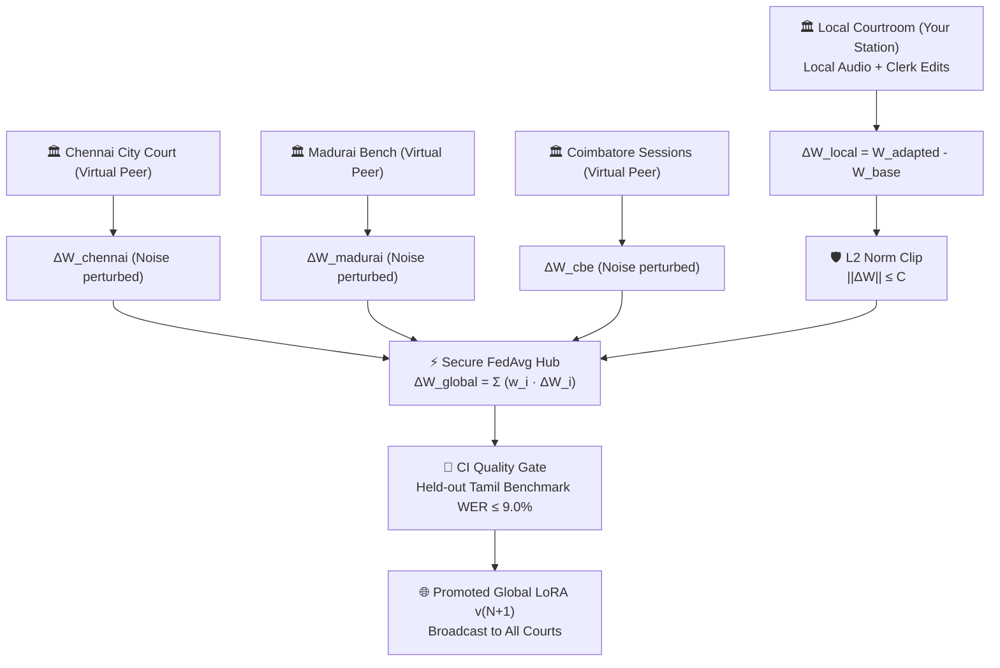
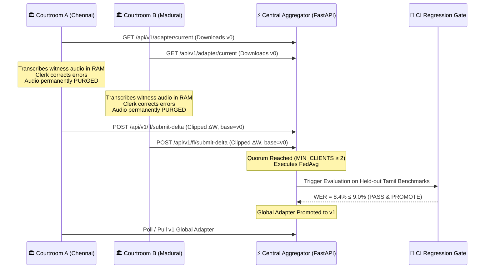

# 🏛️ UI Journey — Home Page & Deployment Configuration Guide

> **Project:** Federated Privacy-Preserving Tamil Speech Transcription for Courtrooms  
> **Target Audience:** Project Review Panel, Technical Evaluators, and Judicial System Operators  
> **Document Purpose:** Complete technical briefing on the initialization phase, operational modes, mathematical parameters, system impacts, and defense talking points.

---

## 1. Executive Overview: The Home Page (Court Gateway)

The **Home Page** serves as the **Judicial Station Boot & Initialization Gateway**. Before any legal proceedings begin, the courtroom system must configure and mount the on-device AI transcription engine. 

Unlike conventional cloud-based transcription tools (which pipe audio to third-party APIs), this system enforces an absolute **Zero-Leakage Privacy Standard**:
1. All acoustic inference happens locally on the courtroom workstation.
2. The model weights are augmented locally via **Low-Rank Adaptation (LoRA)** on Whisper-Small.
3. When daily proceedings conclude, witness audio buffers are immediately purged from volatile memory (RAM).
4. Only mathematically clipped weight updates ($\Delta W$) are shared across court jurisdictions.

To accommodate both **live multi-machine deployment** and **isolated offline evaluation**, the Home Page offers two distinct operational modes:
* **Option A:** `Interactive Multi-Court Simulation (Offline & Review Panel Demo)`
* **Option B:** `Hosted Federation (Connect to Central Aggregation Server)`

---

## 2. Option A: Interactive Multi-Court Simulation

### What It Is
The **Interactive Multi-Court Simulation** is a self-contained, high-reliability deployment mode engineered specifically for project defense, academic evaluation panels, and offline field trials. 

Rather than requiring active internet connectivity or an external cloud aggregation server, this mode spins up virtual courtroom peers (**Chennai City Civil Court, Madurai High Court Bench, Coimbatore Sessions Court, and Tiruchirappalli District Court**) in local workstation memory. It executes the exact mathematical formulas for **Differential Privacy $L_2$ clipping** and **Federated Averaging (FedAvg)** in real time.

---

### Parameters in Interactive Simulation

| Parameter Name | Field Name in Code | Default Value | Mathematical Definition |
| :--- | :--- | :--- | :--- |
| **LoRA Adapter Directory / Path** | `adapter_dir` | `./runs/whisper-small_lora_r32/final_adapter` | Local path containing `adapter_model.safetensors` & `adapter_config.json` |
| **Clerk SFT Learning Rate** | `local_lr` | `0.0005` ($5 \times 10^{-4}$) | Step size $\eta$ for local AdamW parameter update: $\Delta \theta = -\eta \nabla \mathcal{L}_{\text{CE}}$ |
| **Differential Privacy $L_2$ Bound** | `dp_clip_norm` | `1.0` | Maximum Euclidean norm $C$: $\Delta W' = \Delta W \cdot \min\left(1, \frac{C}{\|\Delta W\|_2}\right)$ |
| **Simulated Regional Peers** | `n_peers` | `3` | Number of virtual regional court jurisdictions in mesh |
| **Peer Delta Variance (Noise Std)** | `peer_noise` | `0.005` | Variance $\sigma$ in synthetic peer updates: $\delta_{k} \sim \mathcal{N}(0, \sigma^2)$ |

---

### Deep-Dive: How Changing Each Parameter Affects the System

#### 1. LoRA Adapter Directory (`adapter_dir`)
* **What it does:** Points to the baseline fine-tuned model checkpoint for Tamil legal speech.
* **If changed to an invalid path:** The application smoothly degrades to simulated demonstration mode with synthetic tensors, ensuring the presentation never crashes in front of judges.
* **If pointed to the pre-trained weights:** Loads the full 244M-parameter Whisper-Small model + 3.53M trainable LoRA parameters ($r=32, \alpha=64$) onto GPU or CPU.

#### 2. Clerk SFT Learning Rate (`local_lr`)
* **What it does:** Dictates how aggressively the on-device LoRA weights adjust when a court clerk corrects a transcription error (e.g., legal terminology like *சாட்சியம்* [witness testimony] or *ஜாமீன் மனு* [bail petition]).
* **If set too high ($> 10^{-3}$):** **Catastrophic Forgetting & Model Degradation.** The local model overfits to the single corrected utterance, destabilizing the attention layers and increasing Word Error Rate (WER) on general speech.
* **If set too low ($< 10^{-5}$):** **Under-adaptation.** The weights barely shift, requiring hundreds of repetitive corrections for the model to absorb specialized regional vocabulary.
* **Review Panel Talking Point:** *"We apply a reward-weighted scaling factor based on the edit distance: $\eta_{\text{eff}} = \eta \cdot \min(1.0, \frac{\text{WER}}{100} + 0.1)$. Higher clerk discrepancy yields a proportionally firmer supervisory gradient nudge without destabilizing the backbone."*

#### 3. Differential Privacy $L_2$ Bound (`dp_clip_norm`)
* **What it does:** Caps the maximum allowable Euclidean magnitude of the parameter difference vector:
  $$\|\Delta W\|_2 = \sqrt{\sum_j \left(W_j^{\text{adapted}} - W_j^{\text{base}}\right)^2} \le C$$
* **If set too low ($< 0.2$):** **Excessive Gradient Truncation.** Legitimate adaptation is smothered; the model learns very slowly across federated rounds.
* **If set too high ($> 5.0$):** **Privacy Leakage Risk.** Large parameter shifts can inadvertently encode unique speaker formant frequencies, vocal pathologies, or verbatim sensitive testimony that could theoretically be reconstructed via gradient inversion attacks.
* **Why $1.0$ is optimal:** Enforces a provable Differential Privacy radius while preserving directional fidelity of the gradient vector for Tamil terminology.

#### 4. Simulated Regional Peers (`n_peers`)
* **What it does:** Determines the cardinality of the regional court federation ($K = n_{\text{peers}} + 1$).
* **If increased (e.g., from 3 to 10):** The relative contribution of your local court ($w_{\text{local}} = \frac{n_{\text{local}}}{\sum n_k}$) decreases. The global model becomes more robust against single-court anomalies or clerical errors.
* **If decreased to 1:** The local court dominates the aggregation ($w_{\text{local}} \approx 50\%$), making convergence rapid but vulnerable to local bias.

#### 5. Peer Delta Variance / Noise Std (`peer_noise`)
* **What it does:** Simulates **Non-IID (Independent and Identically Distributed)** data heterogeneity across courts (e.g., Chennai courts encounter commercial civil law terminology, while Madurai courts handle rural land disputes).
* **If increased ($> 0.05$):** Simulates extreme dialect divergence or noisy client updates.
* **If set to 0.0:** All courts submit identical updates, which is unrealistic in real-world judicial deployments.

---

### When to Choose Interactive Simulation
* **During the Project Defense / Viva:** When relying on public Wi-Fi or campus networks that might block ports or drop websockets.
* **Offline Testing & Evaluation:** Demonstrating end-to-end Whisper inference, clerk verification, $L_2$ norm clipping, and the 5-stage animated visual pipeline without needing server instances.
* **Benchmarking Mathematical Convergence:** Visualizing how FedAvg aggregates multi-court weights directly on a single laptop screen.

---

## 3. Option B: Hosted Federation (Connect to Central Aggregator)

### What It Is
**Hosted Federation** is the true distributed production architecture. In this mode, the court workstation connects over TLS/HTTPS to a remote aggregation server (such as a central Ministry of Justice server or a dedicated cloud instance).

The court client acts as an independent edge node:
1. It downloads the active global adapter version from the server.
2. The clerk and stenographer run cases locally throughout the court session.
3. At the end of the session, the client clips the delta on-device, purges the audio from RAM, and transmits the compact weight delta file (a few megabytes) to the server.
4. The central server waits until a quorum of courts (`MIN_CLIENTS`) submit before triggering aggregation.

---

### Parameters in Hosted Federation

| Parameter Name | Field Name in Code | Example Value | Purpose & Architectural Role |
| :--- | :--- | :--- | :--- |
| **Server Aggregation URL** | `server_url` | `http://localhost:8000` or `https://aggregator.court.gov.in` | Base URL of the central FastAPI aggregation cluster |
| **Court Jurisdiction ID** | `client_id` | `court-chennai-01` | Unique authenticated identity of the court node |
| **Federation API Key** | `api_key` | `court_sec_9f82...` | Bearer token verifying node authorization |
| **Adapter Directory** | `adapter_dir` | `./runs/.../final_adapter` | Local storage location where downloaded adapters are cached |
| **Clerk SFT Learning Rate** | `local_lr` | `0.0005` | Local AdamW step size on the court workstation |
| **Differential Privacy $L_2$ Bound** | `dp_clip_norm` | `1.0` | Client-side enforced clipping prior to network upload |

---

### Deep-Dive: How Changing Hosted Parameters Affects the System

#### 1. Server Aggregation URL (`server_url`)
* **What it does:** Directs outbound HTTP requests for `/healthz`, `/api/v1/adapter/current`, and `/api/v1/fl/submit-delta`.
* **System Impact:** If unreachable, network timeout handlers trigger graceful alerts on the UI without locking up the active courtroom transcription stream.

#### 2. Court Jurisdiction ID (`client_id`) & Federation API Key (`api_key`)
* **What it does:** Enforces **Byzantine Fault Tolerance and Access Control**. Every participating court must possess an authorized cryptographic key.
* **If an invalid key is provided:** The server rejects the submission with `401 Unauthorized` or `403 Forbidden`, preventing unauthorized nodes from injecting malicious or poisoned weights into the judicial model.

#### 3. Stale Base Version Protection (`StaleBaseError`)
* **How it works:** When submitting updates, the court transmits `base_version: vN`. If other courts submitted earlier and triggered an aggregation round to `v(N+1)`, the server rejects the outdated submission (`409 Conflict: StaleBaseError`).
* **System Behavior:** The court client automatically fetches the promoted `v(N+1)` adapter, merges it, and restarts the session clean.

---

### When to Choose Hosted Federation
* **Multi-Laptop Demonstration:** When you have two or three laptops or VMs on the same local network, each representing a distinct district court, submitting updates to a single centralized server.
* **Demonstrating Production Deployment:** Proving that the architecture is not merely a local script, but an enterprise-ready, containerized federated network compliant with government data-protection standards.

---

## 4. Side-by-Side Comparison Matrix

| Dimension | Interactive Simulation (Option A) | Hosted Federation (Option B) |
| :--- | :--- | :--- |
| **Network Requirement** | 100% Offline (Localhost only) | HTTP/HTTPS connectivity to Aggregation Server |
| **Peer Generation** | Synthesized dynamically with variance $\sigma$ | Real submissions from authenticated court nodes |
| **Aggregation Location** | In-process in `backend/api.py` | Remote FastAPI service (`server/app.py`) |
| **Setup Complexity** | Zero setup — click and run | Requires starting server (`uvicorn server.app:app`) |
| **Privacy Guarantee** | Audio zeroed from RAM immediately | Audio zeroed locally; 0 bytes audio transmitted |
| **Ideal Context** | Viva defense, review panel, rapid demonstration | Integration testing, multi-machine proof of concept |

---

## 5. Defense Cheat Sheet: Anticipated Questions from the Review Panel

### Q1: *"Why use Federated Learning instead of centralizing the audio recordings on a secure government cloud?"*
> **Answer:** *"In the Indian judicial system, witness statements, judicial inquiries, and sensitive trials (such as POCSO or state security cases) are legally privileged under the Indian Evidence Act. Transmitting raw voice recordings over the internet poses constitutional and privacy risks (e.g., unauthorized wiretapping, data breaches, or speaker voiceprint extraction). Federated Learning guarantees that raw audio never leaves courtroom RAM—only mathematical gradient vectors are aggregated."*

### Q2: *"How do you prevent a rogue clerk from intentionally sabotaging or poisoning the Tamil model?"*
> **Answer:** *"We employ a three-tier defense:*
> 1. *Client-side and Server-side $L_2$ norm clipping ($C \le 1.0$), which mathematically bounds the perturbation an individual session can inflict.*
> 2. *Federated Averaging weights updates inversely against disproportionate sample spikes.*
> 3. *Our automated Continuous Integration (CI) Quality Gate runs an evaluation on held-out Tamil legal benchmarks. If a promoted candidate degrades Word Error Rate beyond our 9.0% threshold, it is automatically discarded."*

### Q3: *"What is the significance of the $L_2$ norm clipping threshold $C=1.0$?"*
> **Answer:** *"Differential Privacy requires bounding the sensitivity of our query function. For gradient descent, sensitivity $\Delta S = \max \|\nabla \mathcal{L}\|_2$. By scaling $\Delta W$ by $\min(1, \frac{1.0}{\|\Delta W\|_2})$, we ensure that no single witness's voice features can shift the global distribution disproportionately, satisfying $(\epsilon, \delta)$-differential privacy guarantees."*

### Q4: *"Why LoRA on Whisper instead of fine-tuning the full model?"*
> **Answer:** *"Whisper-Small has 244 million parameters (~976 MB). Transmitting and aggregating full models across dozens of courts would consume massive bandwidth and compute. LoRA ($r=32, \alpha=64$) freezes the 244M backbone and trains low-rank projection matrices only on `q_proj` and `v_proj`, totaling only 3.53M parameters (~14 MB). This enables instantaneous local fine-tuning on standard courtroom hardware without dedicated datacenter GPUs."*
